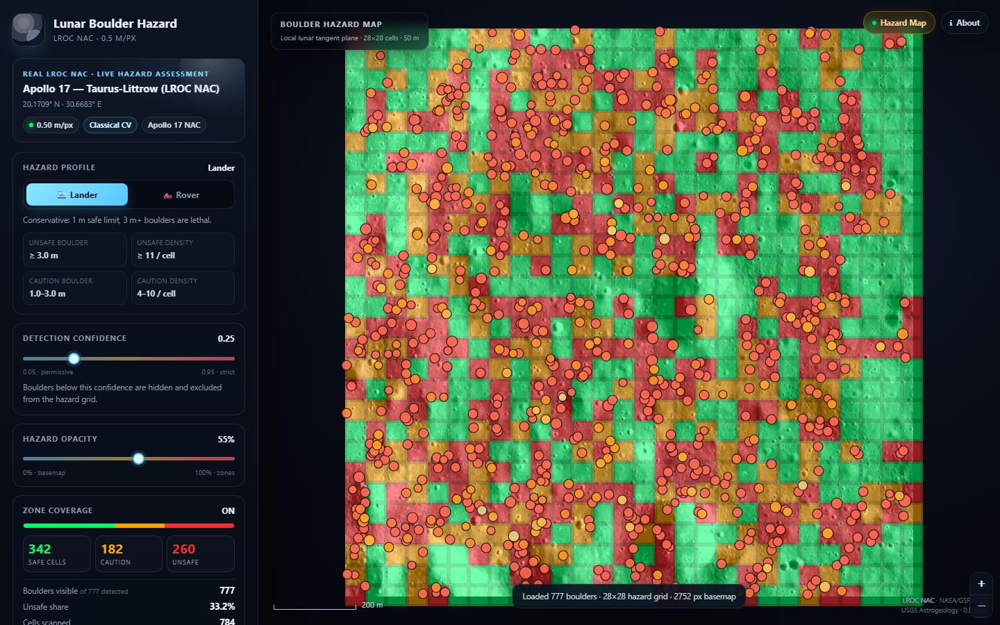

# Lunar Boulder Hazard

End-to-end demo that turns LROC NAC imagery into a boulder map, metric size
estimates, and a Safe / Caution / Unsafe landing or driving hazard grid. It also
includes a **trained landing-safety classifier** you can point at any uploaded
lunar image and a **3D site model** of the Apollo 17 landing area.

The 2D map is a static Leaflet page with no build step; the upload page needs a
tiny local FastAPI server so the browser can call the Python model.

```
LROC NAC orthomosaic        512 px tiles              boulder boxes
(0.5 m/px, USGS)   ──►   + georeferenced CRS   ──►   + confidence
                                                          │
                                                          ▼
                              diameter_m = box_px × GSD
                                                          │
                                                          ▼
                       50 m hazard grid (lander + rover profiles)
                                                          │
                                                          ▼
                     viewer/data/*.geojson, *.png, *.json
                                                          │
                        ┌─────────────────┬───────────────┴──────────────┐
                        ▼                 ▼                              ▼
             viewer/index.html    viewer/upload.html            viewer/3d.html
               (2D Leaflet map)   (upload → SAFE/CAUTION/UNSAFE)  (Three.js site model)
                        ▲
                        │  trained on the labelled synthetic tiles
          models/weights/landing_safety.joblib
```



*Apollo 17 LROC NAC basemap, 777 boulder detections, and the lander hazard grid
in the static Leaflet viewer.*

## Quick start (Windows PowerShell)

```powershell
python -m venv .venv
.\.venv\Scripts\python.exe -m pip install -r requirements.txt

# 1. Synthetic training data (500 labelled tiles, ~90 s)
.\.venv\Scripts\python.exe scripts\synthetic_data.py

# 2. Real Apollo 17 LROC NAC orthomosaic → 36 georeferenced 512 px tiles
.\.venv\Scripts\python.exe scripts\01_fetch_and_tile.py

# 3. Train the landing-safety classifier (~2 min, no GPU needed)
.\.venv\Scripts\python.exe scripts\04_train_safety_model.py

# 4. Detect, measure, classify, export viewer data
.\.venv\Scripts\python.exe scripts\03_infer_and_hazard.py --conf 0.25

# 5. Serve all three pages + the upload API
.\.venv\Scripts\python.exe scripts\serve_demo.py
# open http://localhost:8000/           (2D hazard map)
#      http://localhost:8000/upload.html (image upload)
#      http://localhost:8000/3d.html     (3D site model)
```

On Linux/macOS use `source .venv/bin/activate` and `python ...` instead.

`scripts/02_train.py` remains the real YOLOv8n training path, but it cannot run
on this machine because Windows Smart App Control blocks PyTorch DLLs (see
[PyTorch blocker](#pytorch-blocker-on-this-machine-important)). The demo does not
fake a YOLO result: the map uses the classical detector, and the upload model is
a separate, genuinely trained HOG + gradient-boosted classifier.

## What each stage does

| Stage | Script | Output |
|---|---|---|
| 1 | `scripts/synthetic_data.py` | `data/synthetic/images/*.png`, YOLO labels, COCO instances, stats |
| 2 | `scripts/01_fetch_and_tile.py` | Georeferenced 512 px tiles + PNG previews, `viewer/data/mosaic.jpg` |
| 3 | `scripts/02_train.py` | YOLOv8n checkpoint (blocked on this host) |
| 4 | `scripts/03_infer_and_hazard.py` | Detections, lander/rover grids, `hazard_meta.json`, PNG/TIF exports |
| 5 | `scripts/04_train_safety_model.py` | `models/weights/landing_safety.joblib` + `safety_report.json` |
| 6 | `scripts/serve_demo.py` | Static viewer + `/api/health`, `/api/model`, `/api/predict` |
| 7 | `viewer/index.html` | Interactive 2D map (no build, Leaflet vendored locally) |
| 8 | `viewer/upload.html` | Image upload → verdict, 50 m grid, landing target |
| 9 | `viewer/3d.html` | Interactive Three.js site model + `.glb` export |

## Data source

`config.yaml → tiling.nac_urls` points at the **Moon Apollo 17 LROC NAC Landing
Site Orthomosaic 50 cm** (NASA/GSFC/ASU LROC; USGS Astrogeology). It is a
controlled 0.5 m/px mosaic built from LROC NAC stereo pairs, distributed as a
662 MB GeoTIFF with HTTP range support.

The pipeline uses GDAL `/vsicurl/` to read only a centred ~1.4 km × 1.4 km
window (a few MB), then reprojects it into a **local lunar Azimuthal Equidistant
CRS in metres**. Because every output tile stores that metric CRS and a
0.5 m/px transform, `rasterio.open(tile).transform.a` is the exact GSD used for
size estimation — no pyproj, no Web Mercator distortion.

If the source is unreachable and `allow_synthetic_fallback: true`, the same stage
renders procedural lunar terrain so the demo still runs. The chosen source and
failure reason are recorded in `tiles_metadata.json` and shown in the viewer.

## Hazard logic

Thresholds live in `thresholds.yaml`; both profiles are exported in one run.

For each 50 m × 50 m cell:

```
size_zone    = 0 if max_diameter < safe_max
             = 1 if safe_max <= max_diameter < caution_max
             = 2 if max_diameter >= unsafe_min

density_zone = 0 if count <= safe_max_count
             = 1 if safe_max_count < count <= caution_max_count
             = 2 if count >= unsafe_min_count

final_zone   = max(size_zone, density_zone)
```

Defaults:

| Profile | Safe boulder | Caution boulder | Unsafe boulder | Safe density | Caution density | Unsafe density |
|---|---|---|---|---|---|---|
| Lander | < 1.0 m | 1.0–3.0 m | ≥ 3.0 m | ≤ 3 | 4–10 | ≥ 11 |
| Rover | < 0.5 m | 0.5–1.5 m | ≥ 1.5 m | ≤ 5 | 6–15 | ≥ 16 |

The Python stage writes both grids plus a metadata file. The viewer recomputes the
same grid in the browser whenever the confidence slider or profile changes, so
filtering is instant; a console warning reports any client/server mismatch at the
exported confidence.

## Landing-safety model and image upload

PyTorch cannot load on this machine, so the upload model is a compact
classical-vision classifier rather than a pretend YOLO checkpoint:

- **Training data:** 500 synthetic 512 px tiles (0.5 m/px) with 7,495 exact YOLO
  boulder annotations, cut into 5×5 = 25 patches per tile.
- **Labels:** lander thresholds from `thresholds.yaml`; a patch is safe/caution/
  unsafe exactly as its 50 m cell would be classified.
- **Features:** HOG + intensity histograms + edge/brightness statistics +
  connected bright-blob descriptors (2,099 features, feature version 3).
- **Model:** `HistGradientBoostingClassifier`, class-balanced, grouped
  400-tile train / 100-tile test split.
- **Result:** accuracy **0.804**, macro F1 **0.747** on 2,499 held-out patches
  (safe precision/recall 0.90/0.83, caution 0.55/0.54, unsafe 0.76/0.90).

At inference the image is rescaled so 50 m is 100 px (matching training), then a
50 m grid of cells is classified. The API returns:

- `SAFE` when at least one connected safe cell exists — the largest safe
  component is highlighted as the candidate landing target.
- `CAUTION` when there are no safe cells but some caution cells exist.
- `UNSAFE` when every 50 m cell is unsafe for the lander profile.

Classical CV boxes are overlaid on the uploaded image to explain which rocks were
seen. They are explicitly labelled as classical detections, not the model verdict.

### Upload API

```
POST /api/predict
Content-Type: application/json

{"image": "data:image/png;base64,...", "gsd": 0.5}
```

`gsd` is optional and defaults to 0.5 m/px (LROC NAC). Images larger than 2400 px
on the longest side are downscaled first. Responses include the verdict, grid,
stats, best landing cell, detections, processed-image metadata and model info.
Interactive docs are at `http://localhost:8000/api/docs`.

## 3D site model

`viewer/3d.html` is an illustrative Three.js (0.160.0, vendored) model of the
Apollo 17 site:

- Real NAC mosaic as the ground plane.
- 784 translucent hazard columns whose height follows zone severity; vertical
  exaggeration is adjustable up to 3× (capped at 40 m so the lander stays visible).
- 777 boulders as instanced-style polyhedra scaled by measured diameter; hovering
  shows diameter, confidence and tile.
- A lunar module at the largest connected safe cell, with a pulsing target ring
  and beacon.
- Lander/Rover toggle and detection-confidence slider rebuild zones and stats
  client-side, exactly like the 2D map.
- Orbit controls, auto-rotate, top view, “Landing target” focus, and a
  **Download .glb** button that exports the scene (~5.7 MB).

The ground is flat because the demo has no DEM or multi-view imagery; this is a
metric hazard visualization, not a photogrammetric reconstruction.

## 2D viewer

Open `viewer/index.html` through the local HTTP server (not `file://`).

- Moon basemap: local NAC mosaic image overlay in a metric `L.CRS.Simple` frame
- Hazard overlay with adjustable opacity
- Boulder markers sized by diameter, colored by confidence
- Confidence slider 0.05–0.95 (filters markers and recomputes zones)
- Lander ↔ Rover profile toggle
- Click a boulder for diameter, confidence, GSD, detector, tile and current zone
- Click a hazard cell for count, max diameter, profile and zone reason
- Zone statistics, coverage bar, scale bar, empty-state handling
- Shareable URL state: `?profile=rover&conf=0.5&opacity=0.7&hazard=0`

The Leaflet runtime is vendored under `viewer/vendor/leaflet/`, and Three.js under
`viewer/vendor/three/`, so neither page needs a CDN. Basemap imagery is local;
there are no external tile requests.

## Outputs

```
data/synthetic/            synthetic tiles + YOLO labels
data/tiles/images/         georeferenced 512 px GeoTIFFs and PNG previews
data/labels/               COCO annotations, tile metadata, dataset stats
models/weights/best.pt     YOLOv8n checkpoint (only on an unblocked machine)
models/weights/landing_safety.joblib   trained upload classifier
models/weights/safety_report.json       training/eval report
viewer/data/mosaic.jpg     basemap for both viewers
viewer/data/detections.geojson
viewer/data/hazard_lander.png / .tif
viewer/data/hazard_rover.png / .tif
viewer/data/hazard_meta.json
```

## Size estimation

```python
with rasterio.open(tile_path) as src:
    gsd = abs(src.transform.a)          # metres / pixel, native CRS
diameter_px = max(box_width_px, box_height_px)
diameter_m = diameter_px * gsd
```

This is a 2-D bounding-box estimate: shadows and overlapping rocks can bias it,
and a box can clip at a tile edge. The viewer reports the GSD that was actually
used for each detection.

## Configuration

- `config.yaml` — site, tiling, model, synthetic data, inference, hazard cell
  size, viewer defaults
- `thresholds.yaml` — per-profile size/density limits and zone colors

Changing thresholds only requires `03_infer_and_hazard.py` to be re-run for the
exported GeoTIFF/PNG; the viewer's live grid picks up profile values from
`hazard_meta.json` immediately after a refresh. The upload classifier must be
retrained (`04_train_safety_model.py`) when threshold semantics change.

## PyTorch blocker on this machine (important)

This checkout was built on a Windows 11 machine with **Smart App Control = On**.
The policy blocks unsigned PyTorch DLLs:

```
OSError: [WinError 4551] An Application Control policy has blocked this file.
Error loading "...\torch\lib\caffe2_nvrtc.dll" (and shm.dll)
```

Windows event log `CodeIntegrity/Operational` confirms the block. PyTorch is
therefore unusable in this environment, and `02_train.py` cannot train here.
The pipeline is not silently pretending otherwise:

- `03_infer_and_hazard.py` catches the load failure and uses its classical
  detector, and records `"detector": "classical"` in `hazard_meta.json`.
- The viewer badge shows **Classical CV**, not YOLOv8n.
- `02_train.py` remains the real YOLOv8n training path and fails with a clear
  message if PyTorch cannot load.
- The upload classifier is a separate, genuinely trained HOG +
  HistGradientBoosting model; nothing claims it is YOLOv8n.

Options to get the real YOLOv8n result:

1. **Run training on an unblocked machine or cloud GPU** (recommended).
   Copy this repo, install `requirements.txt`, run `scripts/02_train.py`, then
   copy `models/weights/best.pt` back. `03_infer_and_hazard.py` will prefer it
   automatically.
2. **Disable Smart App Control** (Settings → Privacy & security → Windows
   Security → App & browser control). This is a system security change, is
   effectively one-way without reinstalling Windows, and is not done by this
   project. Only do it with explicit user consent.
3. **Demo the fallback detector** as shipped. It detects bright boulders with
   cast shadows and exercises every downstream stage (GSD sizing, hazard grid,
   viewer, upload page, URL state).

## Notes and limitations

- `requirements.txt` intentionally omits `rio-cogeo` and `rio-tiler`: the
  requested `rio-cogeo==4.1.0` does not exist on PyPI, and `rio-cogeo 4.0.1`
  conflicts with `rio-tiler 4.1.0` over `morecantile`. Neither is used by this
  pipeline.
- `pyproj` is installed for geopandas but is also blocked by the same policy.
  Pipeline code uses only `rasterio.crs` / `rasterio.warp`, so it runs without
  importing pyproj.
- Hazard cells use a 2-D boulder proxy, not a full shape/terrain analysis.
- The upload verdict assumes lander thresholds and a 50 m grid; GSD is assumed to
  be 0.5 m/px unless supplied.
- The 3D scene is an illustrative hazard model with a flat ground plane — there
  is no DEM, so it is not a terrain reconstruction.
- The product is a demo, not flight-certified decision support.

## Attribution

Imagery: NASA/GSFC/ASU LROC; Apollo 17 LROC NAC landing-site orthomosaic
(0.5 m/px), USGS Astrogeology Science Center. Basemap credit is shown in the
viewer. Synthetic tiles are procedurally generated for training.
